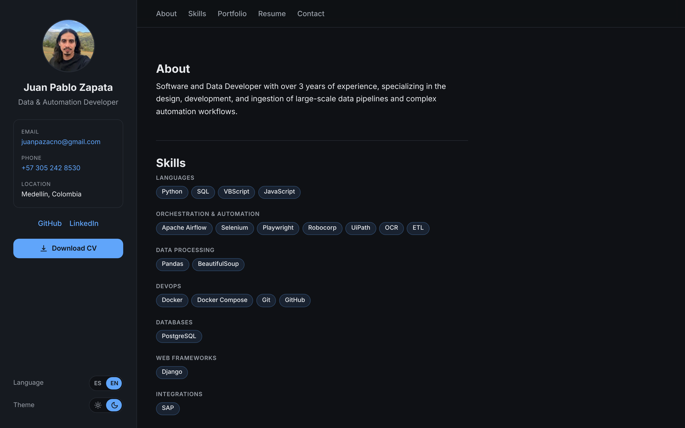

# Juan Pablo Zapata — Portfolio

[](https://github.com/zacno2711/zacno2711.github.io/actions/workflows/deploy.yml)

Personal portfolio of a **Data & Automation Developer** (Python, Apache Airflow, Docker, PostgreSQL).
Live at **[zacno2711.github.io](https://zacno2711.github.io)**.



Most of my data-pipeline work lives inside company systems I can't publish, so this site focuses on
what I can show: skills, experience, and (as they are published) public projects that recreate those
patterns with open data.

## Features

- Bilingual (English / Spanish) with a language switch, one URL per language (`/en/`, `/es/`)
- Dark theme by default, light theme via switch; the choice is remembered
- Skills shown as chips, grouped by category
- Project cards that can only use skills defined in the Skills section (enforced at build time)
- Résumé timeline (experience, education, certifications) and CV download in both languages
- Contact form without a backend, plus direct links
- Optimized profile image, back-to-top button, responsive layout, keyboard and screen-reader friendly

## Tech stack

| Area | Choice |
|---|---|
| Framework | [Astro](https://astro.build) 7 (static output) |
| Language | TypeScript for data and helpers, plain CSS with design tokens |
| Hosting | GitHub Pages |
| CI/CD | GitHub Actions (`withastro/action`) |
| Contact form | [Web3Forms](https://web3forms.com) |
| Icons | [Bootstrap Icons](https://icons.getbootstrap.com) (MIT), inlined as SVG |

No UI framework: the only client-side JavaScript is three small scripts (theme switch, back-to-top
button, contact form).

## Run it locally

Requires **Node.js 22.23.4 or newer**.

```bash
npm install
npm run dev      # dev server with hot reload at http://localhost:4321
npm run build    # generates the static site in dist/
npm run preview  # serves dist/ locally to check the final result
```

## Project structure

```
.
├── .github/workflows/deploy.yml   # build and publish to GitHub Pages on push to main
├── docs/screenshot.png            # image used in this README
├── public/
│   ├── cv/                        # CV PDFs (EN/ES), copied as-is
│   └── favicon.svg
├── src/
│   ├── assets/profile.jpg         # optimized at build time by astro:assets
│   ├── components/                # Sidebar, Timeline, SkillChips, ProjectCard, ContactForm, ...
│   ├── data/                      # site content as typed data (skills, résumé, profile, CV, contact)
│   ├── i18n/ui.ts                 # ES/EN dictionary and helpers
│   ├── layouts/Layout.astro       # base HTML, sidebar, navigation, theme bootstrap
│   ├── pages/
│   │   ├── index.astro            # redirects / to /en/
│   │   └── [lang]/index.astro     # generates /en/ and /es/ from one template
│   └── styles/global.css          # design tokens (dark/light) and base styles
├── astro.config.mjs
└── package.json
```

## Editing the content

| To change... | Edit |
|---|---|
| Skills and their categories | `src/data/skills.ts` |
| Experience, education, certifications | `src/data/resume.ts` |
| Name, email, phone, social links | `src/data/profile.ts` |
| Any visible text (ES and EN) | `src/i18n/ui.ts` |
| CV files | replace the PDFs in `public/cv/`, keeping the same file names |
| Colors and spacing | variables at the top of `src/styles/global.css` |
| Contact form access key | `src/data/contact.ts` |

## Design decisions

**Static site, no server.** All content is resolved at build time and served as plain files, so
hosting is free and there is nothing to maintain or secure on a server.

**One source of truth for skills.** The chips in the Skills section and the chips on project cards
come from the same file, `src/data/skills.ts`. A card can only use skills that exist there.
TypeScript flags unknown skills in the editor, but Astro doesn't stop a build over type errors, so
`assertSkills()` also throws at build time with a message listing the valid options.

**i18n with real URLs.** `/en/` and `/es/` are generated from a single dynamic route. Texts live in
one dictionary with a fallback to the default language. The language switch is a plain link, so it
works without JavaScript and each language is indexable on its own.

**Theme without flicker.** Colors are CSS variables; dark is the base and light is an override. A
tiny inline script sets the theme before the first paint, so there is no flash on load.

**Contact form without a backend.** The form posts JSON to Web3Forms with `fetch`, shows the result
in place, and includes a honeypot field against bots. If no access key is configured, the production
build hides the form instead of shipping one that fails.

**Images.** The profile photo goes through `astro:assets`, which generates a WebP at twice the
displayed size for high-density screens.

## Deployment

Every push to `main` runs `.github/workflows/deploy.yml`, which builds the site and publishes it to
GitHub Pages. One-time setup: *Settings → Pages → Source → GitHub Actions*. The repository is named
`<user>.github.io`, so the site is served from the root and no `base` path is needed.

Before launch: set `NOINDEX` to `false` in `src/layouts/Layout.astro` (it currently asks search
engines not to index the site while it is in progress).

## License

The **source code** is released under the [MIT License](LICENSE).

The **personal content** (photo, CV PDFs, texts, and résumé data) is © 2026 Juan Pablo Zapata, all
rights reserved, and is not covered by the MIT License.

Third-party: [Astro](https://astro.build) (MIT), [Bootstrap Icons](https://github.com/twbs/icons)
(MIT). The GitHub and LinkedIn logos are trademarks of their respective owners and are used only to
link to profiles.
